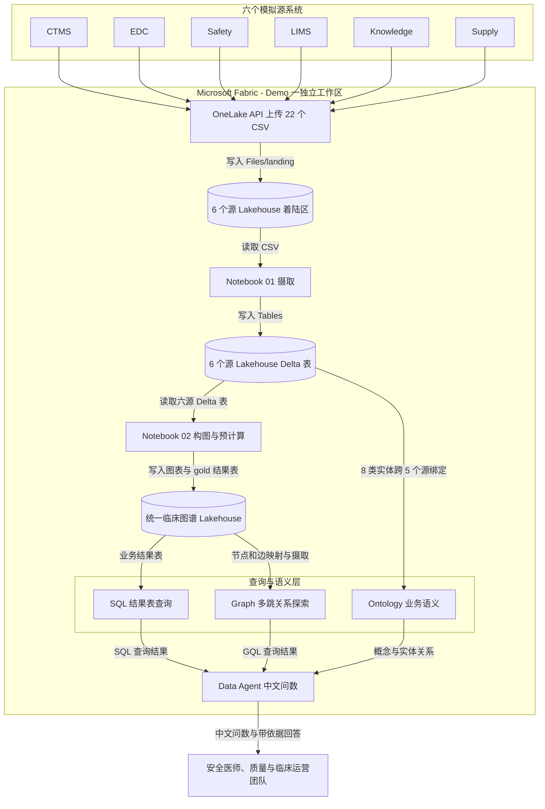
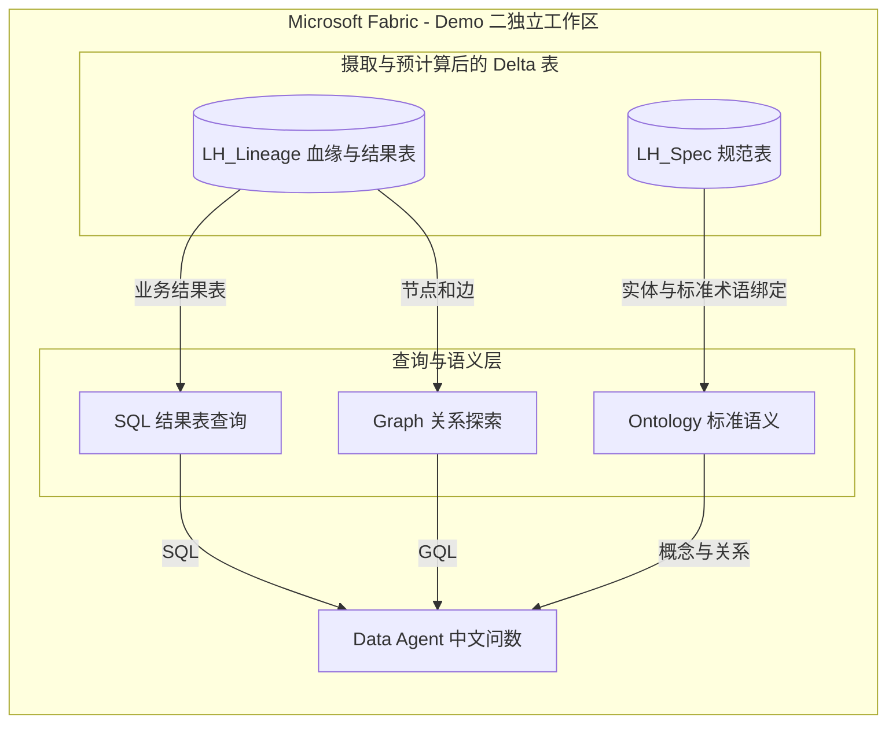

# Microsoft Fabric 制药临床场景 Demo

制药企业并不缺数据，缺的是把**临床运营、给药、安全事件、检验、供应链与机制知识**
连成同一条证据链的能力。一个批次发生质量事件后，谁实际用了它、在哪个中心、
后来出现了什么不良事件，通常需要不同团队分别取数，再人工核对。

本仓库用 Microsoft Fabric 展示两类互补的业务场景：先把临床开发的六个源系统
打通，让安全与运营团队直接问数；再把 CRF 到 SDTM 的映射规范建成血缘图，
让数据管理与统计编程团队追溯来源、评估变更影响。两者都采用
**OneLake 数据底座 + Notebook 确定性计算 + Graph 关系探索 + Ontology 业务语义 + Data Agent 自然语言问答**。

| Demo | 场景 | 面向角色 | 入口 |
|---|---|---|---|
| **[一、跨系统智能问数](#demo-1)** | 批次质量溯源、安全信号证据链、机制解释与中心风险画像 | 安全医师、质量、临床运营、项目发起人 | [演示手册](docs/制药临床跨系统智能Demo演示手册.md) |
| **[二、CRF 到 SDTM 映射血缘](#demo-2)** | 变量来源追溯、字段变更影响、版本差异与标准化治理 | 临床数据管理、统计编程 | [演示手册](docs/CRF到SDTM映射血缘Demo演示手册.md) |

两个 Demo 使用各自独立的工作区与状态文件，互不影响。下方先说明六源系统与整体链路，
再按 Demo 一、Demo 二的顺序介绍业务问题、实测结果和部署方式。

> 全部为合成数据。化合物代号、研究中心、研究者姓名、受试者编号、
> 映射规则与 SDTM 变量清单均为虚构或示意，
> 不含任何真实受试者、试验、产品、客户资料或受保护健康信息，
> 不构成任何医学、监管或用药结论。

---

## 业务背景与六个源系统

临床开发团队需要同时回答两类问题：**发生了什么、涉及谁**，以及
**为什么值得关注、证据有多强**。前者依赖运营系统中的事实记录，后者需要把
不良事件、异常检验与靶点、通路等机制知识关联起来。仅把数据集中到一个湖仓，
还不足以让业务用户理解这些跨系统关系。

Demo 一中的“六个源系统”不是六张表，而是六个职责不同的数据域。
每个系统用一个独立 Lakehouse 模拟，保留数据来源和系统边界：

| 源系统 | 业务职责 | 本 Demo 中的主要数据 | 在跨系统问题中的作用 |
|---|---|---|---|
| **CTMS · 临床试验管理系统** | 管理研究、研究中心、研究者、受试者及方案执行 | 研究、中心、研究者、受试者、方案偏离 | 确定受试者属于哪项研究、哪个中心，支撑中心运营风险画像 |
| **EDC · 电子数据采集系统** | 记录试验过程中的访视与给药事实 | 访视、给药记录，含使用批次 | 将受试者、访视与实际使用的药品批次连接起来 |
| **Safety · 药物警戒与安全数据库** | 管理不良事件及安全信号评估 | 不良事件、严重性、CTCAE 分级、安全信号、事件与信号关联 | 识别受影响受试者中的严重不良事件，并汇总安全信号证据 |
| **LIMS · 中心实验室信息管理系统** | 保存生物标志物测量与检验结果 | 检验值、单位、异常标记、受试者与访视关联 | 为安全信号提供异常检验等客观支持证据 |
| **Knowledge · 转化医学知识库** | 维护候选化合物的作用机制与证据 | 化合物、靶点、通路、生物标志物、不良事件术语及关联 | 解释风险机制，并按证据等级、置信度比较候选链路 |
| **Supply · 临床供应链系统** | 管理临床用药批次与配送 | 批次、运单、送达中心、温度偏移标记 | 从质量事件定位配送范围，再结合 EDC 确认实际用药人群 |

例如，批次温度偏移的完整调查要把 **Supply 的批次与运单 → CTMS 的中心与受试者
→ EDC 的实际给药 → Safety 的不良事件** 串起来；如果还要解释安全信号，
则继续关联 LIMS 的检验结果与 Knowledge 的机制证据。
跨系统关联揭示的是事实与证据链，**不等于证明批次质量事件导致了不良事件**。

### 数据如何进入 Fabric

本仓库演示的是**模拟源系统的批量接入**，没有连接六套真实生产系统，也没有部署实时 CDC。
当前可复现的链路如下：

1. **生成源数据**：[合成数据生成器](tools/generate_clinical_multisource.py)
   在 [data/sources/](data/sources/) 下按六个系统生成 22 个 CSV，
   用一致的研究、中心、受试者、访视、化合物和批次编号建立关联。
2. **上传到 OneLake 着陆区**：[工作区与数据部署脚本](tools/deploy_01_workspace_and_data.py)
   创建工作区、六个源 Lakehouse 和一个统一图谱 Lakehouse；
   通过 OneLake API 将 CSV 上传到各自源 Lakehouse 的 `Files/landing/`。
3. **落成源系统 Delta 表**：[01 摄取笔记本](fabric/notebooks/01_ingest_sources.py)
   读取着陆 CSV，补充 `_source_system` 来源标记，写入各源 Lakehouse 的 `Tables/`，
   并检查所有源表非空。原始文件与可查询表分层保存，不把系统边界抹掉。
4. **构建统一图谱与业务结果**：[02 图谱与洞察笔记本](fabric/notebooks/02_build_graph_and_insights.py)
   读取六个源 Lakehouse 的 Delta 表，按业务标识连接实体，
   在 `LH_Curated_统一临床图谱` 中写入 `graph_nodes`、`graph_edges`、
   五张 `gold_` 业务结果表及问题目录。机制路径、批次影响面、风险分由确定性逻辑计算，
   不是由大模型临时猜测。

真实项目可根据源系统的数据库、文件或接口能力选择接入方式，但需要另行实现并验证，
不属于本仓库已经部署的内容。

### 从 Fabric 到 Data Agent

**Data Agent 不是另一个数据仓库，也不是把全部 CSV 塞进提示词。**
它接入已建好的 Fabric 数据源，根据问题生成查询并组织回答。
[代理部署脚本](tools/deploy_05_data_agent.py) 配置并发布
`ClinicalInsightAgent`，同时注册以下三个数据源：

| 数据源 | 数据从哪里来 | 查询方式与分工 |
|---|---|---|
| `LH_Curated_统一临床图谱` | Notebook 02 产出的图表与业务结果表，经 SQL analytics endpoint 查询 | SQL：五类固定业务问题优先查询预计算的 `gold_` 结果表，稳定复现分析口径 |
| `ClinicalKnowledgeGraph` | 从统一 Lakehouse 的 `graph_nodes`、`graph_edges` 映射并摄取为图索引 | GQL：结果表未覆盖的多跳关系探索、可达性与跨系统连接统计 |
| `ClinicalDevelopmentOntology` | 8 类业务实体、9 类关系，直接绑定 CTMS、Safety、LIMS、Knowledge、Supply 的源表 | 本体：业务概念定义、属性与实体关系理解；不是路径算法的必需组件 |

代理指令定义路由规则；Lakehouse 与 Graph 配有数据源说明和各 5 条示例查询，
用于引导自然语言到 SQL/GQL 的转换。业务用户在 Fabric 门户中用中文提问，
代理查询相应数据源后，说明本次使用的数据源与查询方式，并附上合成数据免责声明。
预计算结果反映最近一次笔记本运行的数据；图索引也需要摄取或刷新，不代表直接实时查询源系统。

外部 AI 应用还可通过 Data Agent 的 MCP 端点调用问数能力。
当前 Demo 中 SQL 问数已验证可用；MCP 下的图查询存在身份限制，
演示关系探索应使用门户交互会话，或通过 GQL Query API 单独验证图查询。

### 方案架构图

下图以 Demo 一为例。注意：**Graph 读取统一图表，Ontology 直接绑定源系统 Delta 表，
Data Agent 同时接入三个数据源**，不是把三者串成一条必须依次经过的链路。

<!-- mermaid-checked: no \n, no em-dash/en-dash, no {} in labels, subgraphs are id["label"], arrows are --&gt;|"label"|, all subgraphs closed by end, ids unique -->


| 组件 | 技术与数据形态 | 职责 |
|---|---|---|
| OneLake + Lakehouse | 着陆 CSV、源 Delta 表、统一图表与结果表 | 统一数据底座，保留系统边界与来源 |
| Notebook | PySpark 摄取 + 共用的 Python 图逻辑 | 确定性构图与预计算，便于复现和验证 |
| Fabric Graph | 基于 Delta 节点、边表的图模型与 GQL | 多跳关系探索，不依赖第三方图数据库 |
| Ontology | 业务实体、属性、关系与源表绑定 | 统一业务语义；Demo 一覆盖 5 个源 Lakehouse |
| Data Agent | 数据源配置、指令与 SQL/GQL 示例查询 | 把自然语言问题路由到合适的数据源并解释结果 |

Demo 二沿用同样的能力分工，但输入是七张映射规范表，而不是这六个临床源系统；
其独立的血缘数据流见下文。

---

<a id="demo-1"></a>

## Demo 一 · 制药临床开发跨系统智能问数

用 Microsoft Fabric 把分散在六个源系统里的临床开发数据统一成一张知识图谱，
让业务用户用中文直接提问，得到可追溯、带证据的答案。

### 一、业务场景

制药企业的临床开发数据天然分散。CTMS 管研究和受试者，EDC 管访视和给药，
药物警戒系统管不良事件和安全信号，中心实验室管检验结果，供应链管批次和运单，
转化医学团队维护靶点与通路知识库。

这些系统各自都能用，问题出在**跨系统的问题没人能快速回答**。

举一个真实会发生的场景。某个药品批次在运输途中出现温度偏移，质量部门需要立刻知道：

> 这个批次发到了哪些研究中心，哪些受试者实际用了它，其中谁发生了严重不良事件。

回答它需要依次查供应链的运单、CTMS 的受试者归属、EDC 的给药记录、安全数据库的不良事件。
四个系统、四拨人、四次取数，通常以天为单位。而这类问题往往是有时限要求的。

本 Demo 覆盖临床开发团队真实会问的五类问题：

| 编号 | 业务问题 | 跨越的系统 |
|---|---|---|
| Q1 | 某候选药物与某个不良事件之间有哪些可解释的机制通路，哪条证据最强 | 知识库 |
| Q2 | 某批次发生温度偏移，影响了哪些中心和受试者，谁发生了严重不良事件 | 供应链 → CTMS → EDC → 安全数据库 |
| Q3 | 某个安全信号的完整证据链是什么 | 安全数据库 → CTMS → EDC → 实验室 → 知识库 |
| Q4 | 共享靶点或通路的其他化合物是否可能共享同一风险 | 知识库 → CTMS |
| Q5 | 哪些研究中心风险最高，分别因为什么 | CTMS → 安全数据库 → 供应链 |

---

### 二、五类问题如何落到查询结果

上述五类业务问题优先走 SQL 结果表，分析逻辑由 Notebook 02 预先执行。
业务用户不需要知道表名，Data Agent 根据问题选择对应结果表：

| 业务问题 | 结果表 | 分析内容 |
|---|---|---|
| Q1 机制解释 | `gold_mechanism_paths` | 枚举机制链路，按证据折损排序，同时保留最差证据等级与最低置信度 |
| Q2 批次影响面 | `gold_batch_impact` | 关联批次、运单、中心、实际用药受试者与不良事件 |
| Q3 信号证据链 | `gold_signal_evidence` | 汇总不良事件、严重事件、受试者、中心、异常检验与机制解释 |
| Q4 共享风险外推 | `gold_target_crosstalk` | 比较化合物共享的靶点、通路及相关风险术语 |
| Q5 中心风险画像 | `gold_site_risk` | 汇总中心的严重不良事件、重要方案偏离与温度偏移，按确定性权重计算风险分 |

当问题超出这些预计算口径时，才转向 Graph 的 GQL 关系探索；
概念定义类问题走 Ontology。三者的职责互补，Ontology 不替代图算法。

---

### 三、Fabric 的价值体现在哪里

#### 1. 一个平台完成从源系统到业务问答的全链路

六个源系统的落地、统一、图建模、语义层、AI 问数，全部在 Fabric 内完成，
不需要把数据另搬到第三方图数据库。着陆文件、源表、统一图表与结果表都保存在 OneLake，
Graph 的图索引是面向查询的派生结构，而不是另接一套业务数据系统。

#### 2. 图是原生能力，不是外挂

跨系统关联天然是图问题。本 Demo 的统一图谱有 **1555 个节点、2950 条边**，
其中跨源系统的连接是价值最集中的部分：

| 关系 | 起点 → 终点 | 边数 | 跨越的系统 |
|---|---|---:|---|
| HAS_VISIT | Subject → Visit | 652 | CTMS → EDC |
| MEASURES | LabResult → Biomarker | 529 | LIMS → Knowledge |
| HAS_LAB_RESULT | Visit → LabResult | 529 | EDC → LIMS |
| USED_BATCH | Visit → Batch | 481 | EDC → Supply |
| CODED_AS | AdverseEvent → AEType | 109 | Safety → Knowledge |
| EXPERIENCED | Subject → AdverseEvent | 109 | CTMS → Safety |
| DELIVERED_TO | Shipment → Site | 27 | Supply → CTMS |
| BATCH_OF | Batch → Compound | 9 | Supply → Knowledge |

这张表由 Data Agent 用一句中文提问生成 GQL 得出。每一行在传统架构下
都需要人工写一段 ETL 打通。

#### 3. 统一算法口径与业务语义

"最佳路径"在临床语境里有歧义。本 Demo 中 SYN-101 到药物性肝损伤有四条链路，
**跳数完全相同都是 4 跳**，只看"最短"根本区分不出来：

| 排名 | 机制链路 | 跳数 | 证据折损 | 最差等级 |
|---:|---|---:|---:|---|
| 1 | SYN-101 → 细胞色素P450 3A4 → 肝药物代谢通路 → 丙氨酸氨基转移酶 → 药物性肝损伤 | 4 | 0.39 | B |
| 2 | SYN-101 → 细胞色素P450 3A4 → 肝药物代谢通路 → 天冬氨酸氨基转移酶 → 药物性肝损伤 | 4 | 0.46 | B |
| 3 | SYN-101 → Janus 激酶 1 → JAK-STAT 信号通路 → 丙氨酸氨基转移酶 → 药物性肝损伤 | 4 | 0.49 | B |
| 4 | SYN-101 → 细胞色素P450 3A4 → 肝药物代谢通路 → 总胆红素 → 药物性肝损伤 | 4 | 0.63 | B |

区分优劣的是证据折损，定义为 `(1 - 置信度) + 证据等级惩罚`，A 级不惩罚，B 级 0.05，
C 级 0.15，D 级 0.30，数值越小证据越强。它是来自图算法边权重的**无量纲指标**，
衡量的是不确定度，与费用、预算、资源投入无关。

这个口径在[共用图逻辑](fabric/graph_logic.py)中统一定义并物化到结果表，
代理通过字段说明与指令解释它；Ontology 则负责业务概念与跨源实体绑定。
这样把算法口径、语义定义与回答依据分别显式维护，而不是依赖大模型即兴判断。
这为复现与审查提供基础，但 Demo 本身不代表已完成 GxP 验证。

与总折损并列给出的还有 `worst_evidence_grade`（链路中最差的一环）与 `min_confidence`
（最低置信度），因为审评场景里人往往先看最弱环节，再看总分。

#### 4. 中文问数直接面向业务用户

不需要业务用户知道表在哪、字段叫什么。实测的问答效果：

**问**：批次 BATCH-007 发生温度偏移，影响了哪些中心和受试者？其中谁发生了严重不良事件？

**答**：3 家研究中心、18 名受试者、13 条严重不良事件，全部为 QT间期延长，
CTCAE 3 至 4 级，并给出完整链路
`BATCH-007 → SHIP-0019 → 西安长安医院 → SUBJ-0096 → QT间期延长（4级，可能有关）`。

回答中带证据等级、置信度、数据版本，并自动附加合成数据免责声明。

#### 5. 算法确定性，结果可复现可审计

路径与风险分由 BFS、Dijkstra 和确定性公式计算，不是模型打分。
同样的输入永远得到同样的输出,这是受监管行业能否落地的前提。

---

### 四、数据规模与 Lakehouse 一览

| 源系统 | Lakehouse | 主要表 |
|---|---|---|
| CTMS 临床试验管理 | `LH_CTMS_临床试验管理` | studies, sites, investigators, subjects, protocol_deviations |
| EDC 电子数据采集 | `LH_EDC_电子数据采集` | visits, dosing_records |
| Safety 药物警戒 | `LH_Safety_药物警戒` | adverse_events, safety_signals, ae_signal_links |
| LIMS 中心实验室 | `LH_LIMS_中心实验室` | lab_results |
| Knowledge 转化医学知识库 | `LH_Knowledge_转化医学知识库` | compounds, targets, pathways, biomarkers, ae_terms 及四张关系表 |
| Supply 临床供应链 | `LH_Supply_临床供应链` | batches, shipments |

3 项临床研究、12 个研究中心、120 名受试者、652 次访视、2608 条检验结果、
109 例不良事件、3 个安全信号、9 个批次、27 张运单。

统一后：1555 个节点、2950 条边，覆盖 16 类业务实体。

---

### 五、快速开始

前置条件：F2 或更高的 Fabric 容量、租户已启用 Ontology 预览、已 `az login`。

```bash
python3 tools/generate_clinical_multisource.py     # 生成六个源系统的合成数据
python3 tools/validate_graph_logic.py              # 本地验证图逻辑与五类业务答案
python3 tools/deploy_01_workspace_and_data.py      # 工作区、7 个 Lakehouse、上传着陆数据
python3 tools/deploy_02_notebooks.py               # 部署并运行摄取与图谱笔记本
python3 tools/deploy_03_graph_model.py             # 图模型，含定义回读校验
python3 tools/deploy_04_ontology.py                # 本体，8 实体 9 关系跨 5 源系统
python3 tools/deploy_05_data_agent.py              # 数据代理，三个数据源
```

全部脚本幂等，可重复运行。业务讲解见
[演示手册](docs/制药临床跨系统智能Demo演示手册.md)，逐步操作与回归见
[操作文档](docs/制药临床跨系统智能Demo操作文档.md)，
客户演示可直接打开[幻灯片](docs/制药临床跨系统智能Demo幻灯片.html)。

---

### 六、工程实践

**图逻辑单一来源**。构建与分析逻辑放在 [fabric/graph_logic.py](fabric/graph_logic.py)，
本地验证脚本直接导入，部署脚本在生成笔记本时内联注入。
两边共用一份代码，不会出现"本地跑通、云端结果不同"的漂移。

**先本地验证再上云**。[validate_graph_logic.py](tools/validate_graph_logic.py)
用生成的 CSV 完整跑一遍五类分析并断言结果，
逻辑错误在本地暴露，不消耗云端算力试错。

**关键链路显式植入**。BATCH-007 的温度偏移、受试者用药与后续不良事件的关联，
都是在数据生成阶段构造的而非碰运气，因此演示答案稳定可复现。

**断言写进笔记本**。02 笔记本末尾校验节点数、边数、关键机制路径、
BATCH-007 影响链中是否有严重不良事件。任一失败作业即失败，
避免"跑成功了但表是空的"这种最难发现的问题。

**部署即校验**。图模型部署后会回读定义并断言节点与边类型非空,
因为 Fabric 对错误的图定义文件名会返回成功但留下空模型。

---

### 七、已知限制

- Ontology 与 Fabric Graph 仍包含预览能力，不应作为受监管临床决策的唯一依据。
- 图查询（GQL）在门户交互式会话与官方 GQL Query API
  （`POST /v1/workspaces/{ws}/GraphModels/{id}/executeQuery?preview=true`）中均正常；
  但通过 Data Agent 的 MCP 端点用 Azure CLI 令牌调用时会返回 `Access token is invalid`，
  同一代理的 SQL 查询不受影响。
- 全部数据为合成数据，机制关联与证据等级为演示构造，不反映任何真实生物学结论。
- 风险分与证据折损的权重为演示设定，实际落地需与客户的安全与质量团队共同定义。
- Fabric 官方文档目前仍说明 Data Agent 不支持非英语提问，但本 Demo 的中文问题
  已通过真实调用验证。生产使用建议保留英文别名与中文回归测试集。

---

<a id="demo-2"></a>

## Demo 二 · CRF 到 SDTM 映射血缘

CRF（病例报告表）定义临床数据采集项，SDTM（Study Data Tabulation Model）组织标准化数据。
临床数据管理与统计编程团队需要把两者的对应关系、转换算法和适用条件写成映射规范，
并在采集字段或规范版本变化时复核下游影响。

一份映射规范本质上是一张**关系网**：一个 CRF 字段流向哪些标准变量，
一个标准变量从哪几处汇集而来，改一处会牵动多远。

今天这张网通常存在于 Excel 里。Excel 能**存**关系，但跨表、多跳的溯源与影响分析
仍需要人工逐项核对，容易漏掉间接派生关系。

| 业务动作 | 今天怎么做 | 需要的能力 |
|---|---|---|
| 这个变量到底从哪来的 | 全表搜变量名，人工排重 | 反向溯源 |
| 改这一栏会连累谁 | 逐行看，多跳的容易漏 | 正向影响分析 |
| 版本升级改了什么 | 两份文件肉眼比对 | 版本差异 |
| 哪些该交的还没采 | 拿标准清单人工核对 | 覆盖率检查 |
| 补充数据集里的能不能挪回去 | 凭经验判断 | 治理决策支持 |

### 方案架构与数据流

此 Demo 的输入是 [data/spec/](data/spec/) 中七张合成规范表：
表单、字段、SDTM 域、SDTM 变量、映射规则、变量派生关系与受控术语。
部署脚本将 CSV 上传到 `LH_Spec_映射规范库` 的 OneLake 着陆区；
Notebook 11 摄取并校验表结构、参照完整性与本体绑定所需的唯一主键，
Notebook 12 构建血缘图与治理结果表，写入独立的 `LH_Lineage_血缘图谱`。

`ClinicalDataLineageAgent` 接入 Lakehouse 的 SQL 结果表、
`CrfSdtmLineageGraph` 与 `ClinicalDataStandardOntology`。
下图聚焦摄取与预计算完成后的组件关系：

<!-- mermaid-checked: no \n, no em-dash/en-dash, no {} in labels, subgraphs are id["label"], arrows are --&gt;|"label"|, all subgraphs closed by end, ids unique -->


### 关键设计：只做规范层，不做实例层

```text
规范层图（本方案采用）          实例层血缘（本方案不做）
  映射规则本身                   某条具体记录的实际来源
  百级节点、百级边                随受试者与访视线性膨胀，百万级起
  不随受试者增长                  索引成本与刷新时间失控
  值得建图                       数据库稽查轨迹已覆盖
```

这条边界决定了方案的成本能不能控住。演示时如果被问"能不能追到每一条数据"，
答案是"能，但不该在这层做"——这比直接说"能"更有说服力。

### 实测结果

血缘图 **186 个节点、248 条边**，来自 12 张表单、59 个 CRF 字段、
13 个 SDTM 域、102 个 SDTM 变量、65 条映射规则、22 条派生关系。

| 问题 | 实测答案 |
|---|---|
| 治疗组从哪来 | `DM.ARMCD` 两条来源：分配的治疗组（Copy，折损 0.02）与队列（Lookup，0.15），后者仅用于未随机化研究 |
| 改给药开始日期影响谁 | 6 个变量、跨 5 个域、最长 3 跳：`给药开始日期 → EX.EXSTDTC → DM.RFSTDTC → DM.AGE` |
| 版本升级改了什么 | 4 处：2 新增、1 移除、1 算法变更（Lookup → Assigned，下游取值范围可能收窄） |
| 哪些该交的没采 | 6 项真实缺口，其中 1 项必填（已排除系统赋值变量，否则会膨胀到 33 条假缺口） |
| 补充数据集能否上提 | 2 项候选，折损各 0.28，其中 0.15 正来自"落在补充限定符域" |

### 映射折损

多条路径到达同一变量时，跳数少不等于可信——一次条件赋值可能比两次直接拷贝
更需要人工解释。于是给每种转换方式一个权重：

| Copy | CopyUpcase | Assigned | DT2DTC | Lookup | IfAssigned | Coding | Derived |
|---:|---:|---:|---:|---:|---:|---:|---:|
| 0.02 | 0.03 | 0.05 | 0.10 | 0.15 | 0.20 | 0.25 | 0.30 |

额外加权：落在补充限定符域 +0.15，目标变量无受控术语约束 +0.10。

**折损是无量纲权重，与金额、工时、预算没有任何关系。** 一旦被理解成成本估算，
这个指标就失去意义。

### 三种 Fabric 能力的分工

| 数据源 | 承担什么 | 选择理由 |
|---|---|---|
| Lakehouse · SQL | 六类预先算好的治理结果表 | 问题固定、要求稳定复现，优先查询预计算结果 |
| Graph · GQL | 结果表未覆盖的任意关系探索 | 用 GQL 原生表达变长路径，比维护多级 SQL 关联更直接 |
| Ontology | 概念是什么、概念之间什么关系 | CDISC 标准词汇与业务说法之间需要一层显式映射 |

本体在这个场景里特别有价值：SDTM 域、变量、受控术语是**国际公认的标准词汇**，
业务用户说"受试者的处置结论"，标准名是 `DS.DSDECOD`。本体把这层对应显式建模，
用户就不必先学会标准术语才能提问。已实例化 287 个实体。

### 快速开始

前置条件与 Demo 一相同，但部署资源和状态文件独立。

```bash
python3 tools/generate_crf_sdtm_spec.py          # 生成示意性规范数据
python3 tools/validate_lineage_logic.py          # 本地验证：参照完整性 + 分析口径
python3 tools/deploy_lineage_01_data.py          # 工作区、湖仓、数据、笔记本
python3 tools/deploy_lineage_02_graph.py         # 图模型 + GQL 冒烟测试
python3 tools/deploy_lineage_03_ontology.py      # 本体 + 索引刷新 + 实例化校验
python3 tools/deploy_lineage_04_data_agent.py    # 中文数据代理
```

验证：

```bash
python3 tools/test_lineage_questions.py          # 六个业务口吻的问题
python3 tools/test_lineage_sources.py            # 数据源可用性 + 口径正确性
python3 tools/test_lineage_graph_queries.py      # GQL 直连验证图能力
```

详见[操作文档](docs/CRF到SDTM映射血缘Demo操作文档.md)与
[演示手册](docs/CRF到SDTM映射血缘Demo演示手册.md)，
客户演示可直接打开[幻灯片](docs/CRF到SDTM映射血缘Demo幻灯片.html)。
Graph、Ontology 的预览性质及 MCP 图查询限制同样适用。

### 这个 Demo 里最值得记住的一个坑

**数据代理的某个数据源坏掉时，它可能不报错。** 它可能用模型自己的通用知识回答，
或者更糟——换一个数据源算出一个**口径不同但看起来合理**的数字。

实测例子：问"每种转换方式用了多少次"，图数据源不可用，于是它从 SQL 结果表里按
*整条路径的算法串*分组，给出了 14 项包含 `DT2DTC -> Derived` 这种"算法"的清单。
数字有理有据、排序也对，但答的根本不是同一个问题。

处理方式有两条，缺一不可：

1. 代理指令明确禁止跨数据源替代作答，数据源不可用就说不可用然后停下。
2. 把容易被答错的口径**预先算好**成一张表（`gold_algorithm_usage`），让 SQL 也能答对。

只做第 1 条不够——模型会觉得自己"找到了办法"。把正确口径准备好才是根治。
[test_lineage_sources.py](tools/test_lineage_sources.py)
用一条禁止出现箭头的断言守住这个回归。

---

## 仓库结构

```text
data/
  sources/             Demo 一：六个模拟源系统的着陆区 CSV
  spec/                Demo 二：七张映射规范 CSV
fabric/
  graph_logic.py       Demo 一：图构建与五类业务分析（单一来源）
  lineage_logic.py     Demo 二：血缘图构建与六类治理分析（单一来源）
  notebooks/           四个 Fabric 笔记本源码
  deployment_state.json         Demo 一已部署资源 ID
  lineage_deployment_state.json Demo 二已部署资源 ID
tools/
  generate_clinical_multisource.py / generate_crf_sdtm_spec.py  合成数据生成器
  validate_graph_logic.py / validate_lineage_logic.py           本地验证
  deploy_01..05_*.py            Demo 一幂等部署脚本
  deploy_lineage_01..04_*.py    Demo 二幂等部署脚本
  test_*.py                     回归与探测脚本
  livy_run.py                   Livy 会话跑 PySpark，用于拿笔记本的真实报错
docs/
  制药临床跨系统智能Demo*.md/html        Demo 一手册、操作文档、幻灯片
  CRF到SDTM映射血缘Demo*.md/html         Demo 二手册、操作文档、幻灯片
  AI智能体跨MCP架构.md / *幻灯片.html    跨 MCP Server 的智能体编排架构方案
```
